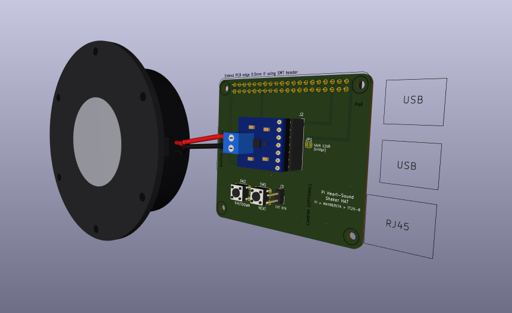
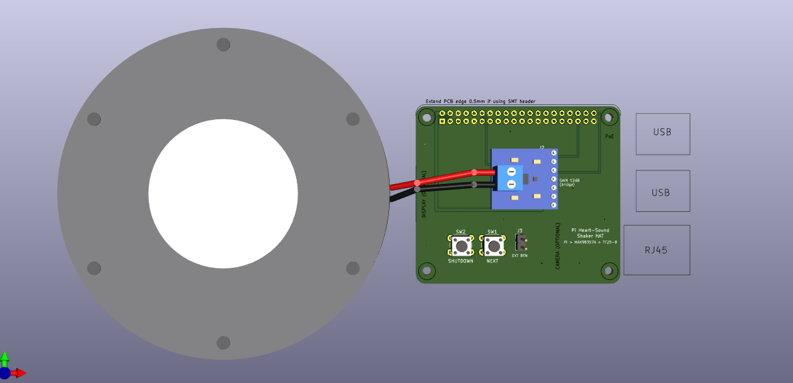
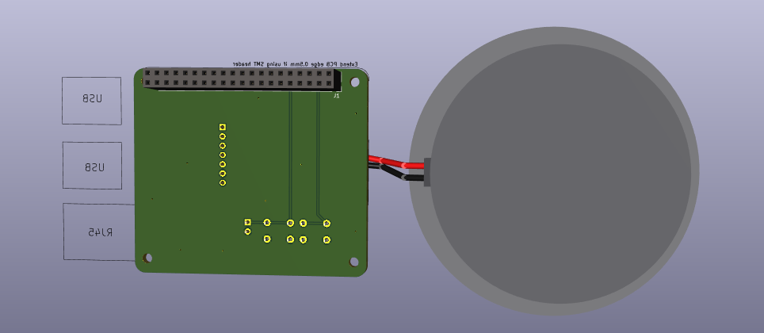

# Pi Heart-Sound Shaker HAT

**A Raspberry Pi HAT that plays heart sounds through a bass shaker, so you can *feel* them through a stethoscope or a manikin.**

The Pi plays audio over I²S → an Adafruit MAX98357A class-D amp → a Dayton Audio TT25-8 tactile transducer ("puck" shaker). Put the shaker under a manikin's chest or a pad, put a stethoscope on it, and you get realistic normal/abnormal heart sounds for clinical skills practice (e.g. OSCE stations). One button skips to the next track; another safely shuts the Pi down.



| Front | Back |
|---|---|
|  |  |

---

## At a glance

| | |
|---|---|
| **Form factor** | Standard Pi HAT outline, 65 × 56.5 mm, 4 × M2.5 mounting holes |
| **Layers** | 2-layer PCB |
| **Fits** | Any Pi with a 40-pin header (Zero 2 W, 3, 4, 5) |
| **Audio path** | Pi I²S → MAX98357A breakout (3 W, mono) → TT25-8 shaker (8 Ω) |
| **Controls** | `NEXT` button (GPIO17), `SHUTDOWN/WAKE` button (GPIO3), optional off-board button header |
| **Power** | 5 V from the Pi's 40-pin header (USB power bank works fine) |
| **Tool** | KiCad 8.0 |
| **Status** | Rev 1 — DRC 0 violations, ERC 0 errors ([reports](docs/reports/)) |

---

## Repository layout

```
pi_heart_shaker/
├── pi_heart_shaker.kicad_pro     KiCad project — open this
├── pi_heart_shaker.kicad_sch     Schematic
├── pi_heart_shaker.kicad_pcb     PCB layout
├── fp-lib-table                  Points KiCad at the project footprint library
├── pi_heart_shaker.pretty/       Project footprints (TT25-8 shaker 3D placeholder)
├── 3d/                           3D models (MAX98357A breakout, TT25-8 shaker) for renders
├── software/
│   ├── heart_player.py           Player: loops a track, NEXT button skips
│   ├── heart-player.service      systemd unit (starts the player at boot)
│   ├── install.sh                One-shot installer for Raspberry Pi OS
│   └── sounds/                   Put your .wav heart-sound recordings here
├── fab/
│   ├── gerbers/                  Gerbers + drill files, ready to upload to a fab
│   ├── bom.csv                   Short BOM (on-PCB parts)
│   └── bom_full.csv              Full build list incl. off-board parts
└── docs/
    ├── schematic.pdf             Schematic export (read without KiCad)
    ├── renders/                  3D renders
    └── reports/                  DRC / ERC reports
```

---

## How it works

```
 Raspberry Pi                       HAT                          off-board
┌─────────────┐   I²S (BCLK/LRC/DIN)   ┌──────────────────┐  speaker +/-  ┌──────────────┐
│ GPIO18/19/21├────────────────────────►│ MAX98357A (J2)   ├──────────────►│ TT25-8 puck  │
│        5 V  ├────────────────────────►│ Vin              │               │ bass shaker  │
│      GPIO17 │◄── SW1 NEXT / J3 ext.   └──────────────────┘               └──────────────┘
│       GPIO3 │◄── SW2 SHUTDOWN / WAKE
└─────────────┘
```

### Pin map

| Signal | Pi header pin | Pi GPIO | Goes to |
|---|---|---|---|
| `I2S_BCLK` | 12 | GPIO18 | J2-2 (BCLK) |
| `I2S_LRCLK` | 35 | GPIO19 | J2-1 (LRC) |
| `I2S_DIN` | 40 | GPIO21 | J2-3 (DIN) |
| `BTN_NEXT` | 11 | GPIO17 | SW1, J3-1 (to GND, use internal pull-up) |
| `BTN_SHUTDOWN` | 5 | GPIO3 | SW2 (to GND) |
| `+5V` | 2, 4 | — | J2-7 (Vin) |
| `GND` | 6, 9, 14, 20, 25, 30, 34, 39 | — | J2-6, buttons, JP1 |
| `AMP_GAIN` | — | — | J2-4 ↔ JP1 |

J2-5 (`SD`, amp shutdown) is left unconnected, so the amp is always on and outputs a (L+R)/2 mono mix.

### Amp gain (JP1)

| JP1 | MAX98357A GAIN pin | Gain |
|---|---|---|
| Open (default) | floating | 9 dB |
| Bridged with solder | GND | 12 dB |

---

## Bill of materials

- Adafruit I²S 3W Class D Amplifier Breakout — MAX98357A (Adafruit #3006)
- Dayton Audio TT25-8 tactile transducer (8 Ω)
- Raspberry Pi with 40-pin header (Zero 2 W needs a header soldered on)
- microSD card with Raspberry Pi OS
- 5 V USB power bank
- 4 × M2.5 standoffs + screws
- 2-conductor speaker wire

---

## Building one

1. **Order the PCB.** Zip the contents of [`fab/gerbers/`](fab/gerbers/) and upload to any PCB fab (JLCPCB, PCBWay, OSH Park…). Defaults are fine: 2 layers, 1.6 mm, any colour.
2. **Solder the HAT.**
   - J1 (2×20 socket) goes on the **bottom** side.
   - J2, J3, SW1, SW2 on the top.
   - Optionally bridge JP1 for 12 dB gain.
3. **Prepare the amp.** Solder the pin header that ships with the MAX98357A breakout so it plugs into J2 (pin order on the silkscreen: LRC, BCLK, DIN, GAIN, SD, GND, VIN).
4. **Wire the shaker** to the breakout's `+`/`-` screw terminal.
5. **Mount** on the Pi with M2.5 standoffs.

---

## Pi software

The [`software/`](software/) folder holds a small Python player that starts at boot:

- It **loops** the current heart-sound recording through the shaker.
- **NEXT** (SW1 or the J3 off-board button) skips to the next `.wav` file, in filename order, and goes back to the first after the last.
- **SHUTDOWN/WAKE** (SW2) safely powers the Pi down, and pressing it again wakes it. This needs no code: the `gpio-shutdown` overlay handles it.
- The script finds the MAX98357A sound card automatically.

### Install

On a Pi running Raspberry Pi OS (Bookworm or newer):

```bash
git clone <this repo> pi_heart_shaker
cd pi_heart_shaker/software
cp ~/my-heart-sounds/*.wav sounds/      # 01_normal.wav, 02_aortic_stenosis.wav, ...
sudo bash install.sh
sudo reboot
```

`install.sh`:

1. Installs `python3-gpiozero` and `alsa-utils`.
2. Copies the player to `/opt/heart-shaker/` and your recordings to `/opt/heart-shaker/sounds/`.
3. Adds these lines to `config.txt`, after saving a backup copy as `config.txt.bak-heart-shaker`:
   ```ini
   dtparam=audio=off
   dtoverlay=max98357a
   dtoverlay=gpio-shutdown
   ```
4. Installs and enables the `heart-player` systemd service.

### Use and troubleshooting

```bash
journalctl -u heart-player -f            # watch which track is playing
sudo systemctl restart heart-player      # after changing settings
aplay -l                                 # the MAX98357A should appear as a sound card
speaker-test -c 2 -t sine -f 60          # low test tone (stop the service first)
```

To add or change recordings later, copy them into `/opt/heart-shaker/sounds/`. The player picks them up the next time a track starts. See [`software/sounds/README.md`](software/sounds/README.md) for tips on preparing files.

To run it by hand without the service: `python3 heart_player.py --sounds ./sounds` (options: `--device`, `--next-pin`).
